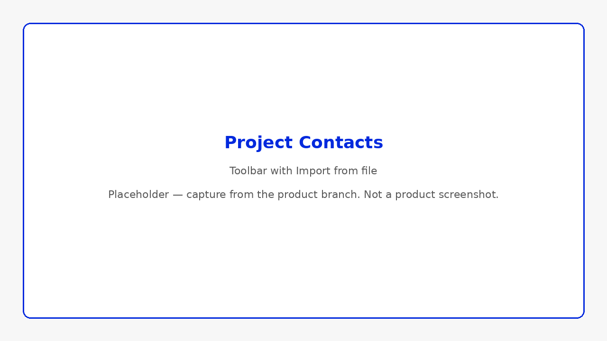
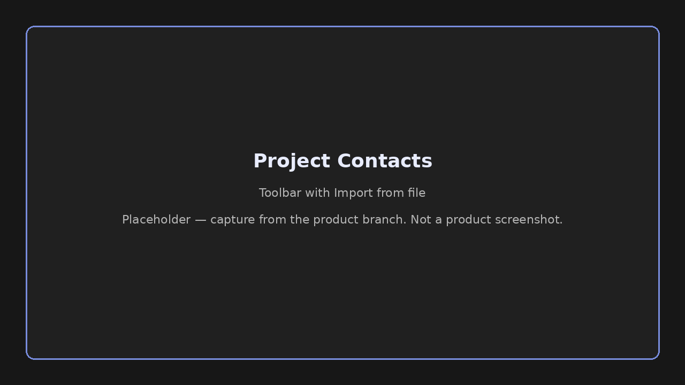
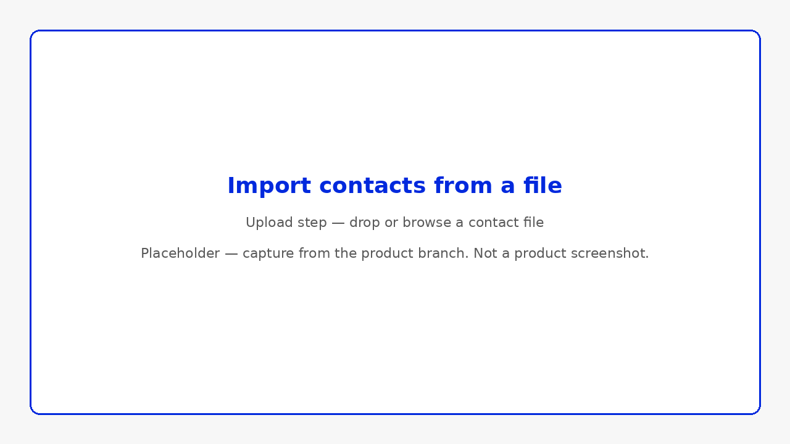
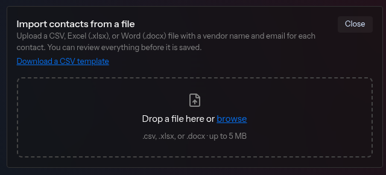
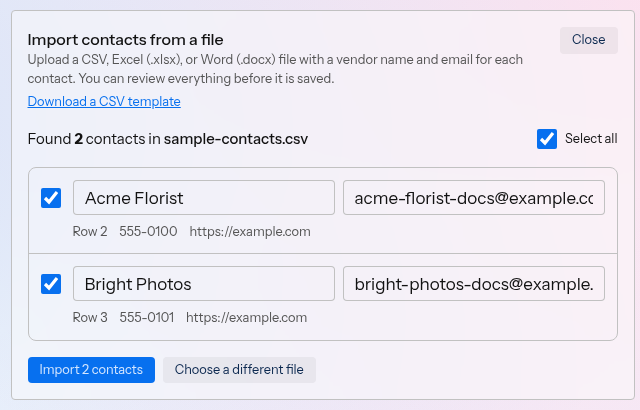
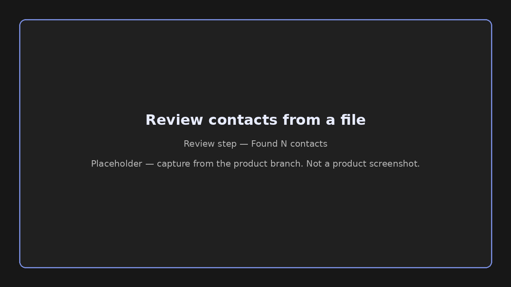

## What you'll accomplish

Add or upload contacts. Enter one contact yourself, or upload a file to import several at once. To search for contacts, see [Find contacts](/help-center/contacts/find-contacts).

## Add a contact manually

1. On **Contacts**, click **+ New contact**.
2. Enter the contact's **Name** and **Email**.
3. Optionally enter a **Type**. Enter any label you want, such as *Florist* or *Photographer*. Envoy groups the contact under that type. Leave **Type** blank to place the contact under **Other** when groups are shown.
4. Optionally enter a **Website**, such as `example.com`. The website shows as a link on the contact row and in search results.
5. Click **Add Contact**.

You can enter the same optional **Type** and **Website** when you click **+ New contact** on a project **Overview** tab.

## Import contacts from a file

Upload a file to add several contacts at once. Each contact needs a name and an email address. Phone and website are optional. Import them once, then attach them to a later project with **+ Attach existing**.

### From the Contacts page

1. Go to **Contacts**.
2. Click **Import from file**, next to **🔍 Find additional contacts** and **Edit**.

### From a project

1. Open the project and go to the **Overview** tab.
2. In the **Contacts** section, click **Import from file**, next to **🔍 Find new contacts**.

Envoy opens a panel titled **Import contacts from a file**.

### Choose a file

1. Upload a `.csv` or `.xlsx` file by dropping it on the panel, or browse for one. The file must be 5 MB or smaller.
2. Click **Download a CSV template** if you want the expected columns.

The template columns are **Vendor Name**, **Email**, **Phone**, and **Website**. **Vendor Name** is the name of the contact. The template includes one example row. Envoy never imports that example row.

### Review the contacts

The panel shows **Found N contacts in**, followed by the file name. Envoy includes only the first 500 contacts. When the file has more, the panel notes that you should split the file and import the rest separately.

1. Edit **Name** or **Email** on a row that needs a change. Phone and website are shown under the name and email.
2. Check the contacts you want to import. Click **Select all** to check the rows you can import.
3. Click **Import N contacts**. On a project, the button reads **Import N contacts to project**.

Envoy calls out a row when:

- The name or email is missing
- The email address is not valid
- The email is the example from the template
- The same email appears more than once in the file
- The contact is already in **Contacts**

A missing name, a missing email, or an invalid email stays importable after you fix it, or you can leave that row unchecked. The template example cannot be selected and is not imported. A duplicate email in the file starts unchecked. A contact already in **Contacts** cannot be selected again on this page, and on a project Envoy adds that contact to the project instead.

When a contact matches a verified Envoy listing with the same email or the same name, Envoy offers a choice that begins with "Use the verified listing". When that listing applies, the contact can show **Onboarded to Envoy**. See [Contact badges explained](/help-center/contacts/contact-badges-explained).

### Read the summary

After the import, Envoy summarizes what happened:

- New contacts
- Verified listing links
- Contacts already there
- Contacts added to the project
- Contacts skipped

Click **Import another file** to bring in another file, or click **Done** to close the panel.

<Note>
  If the file cannot be imported, Envoy shows one of these messages:

  - **Contact files must be 5 MB or smaller.**
  - **We could not read this file. Please try again.**
  - A message that begins with **No contacts were found** when Envoy finds no contacts in the file
  - **This file does not look like a CSV. Export it as CSV (UTF-8) and try again.**
</Note>

## Edit a contact

These steps are on the **Contacts** page.

1. Click **Edit** beside **Import from file**. The button switches to **Done**.
2. On the contact, click **Edit**.
3. Update **Name**, **Email**, or **Website**. You can leave **Email** blank. A contact without an email can't be used for outreach.
4. Click **Save**, or **Cancel** to leave the contact unchanged.
5. Click **Done** when you finish.

On a project's **Contacts** section, **Edit** also switches to **Done**. That list does not have a per-contact **Edit**.

## Trusted listing matches

When adding a contact, Envoy may detect an existing trusted listing:

> A trusted listing may already exist

Choose one:

- **Use listing** — Link to the verified or existing listing in Envoy's directory
- **Create separate contact** — Save as a standalone entry in your directory

<Snippet file="snippets/badge-onboarded.mdx" />

## Remove a contact

These steps are on the **Contacts** page.

1. Click **Edit** beside **Import from file**.
2. On the contact, click **Remove**.
3. When the row shows **Remove?**, click **Yes**, or click **Cancel** to keep the contact.

On a project's **Contacts** section, the row action is **Detach**. **Detach** still asks **Remove?** and then **Yes** or **Cancel**.

## Related

- [Find contacts](/help-center/contacts/find-contacts)
- [Contact badges explained](/help-center/contacts/contact-badges-explained)
- [Attach contacts to projects](/help-center/contacts/attach-contacts-to-projects)
