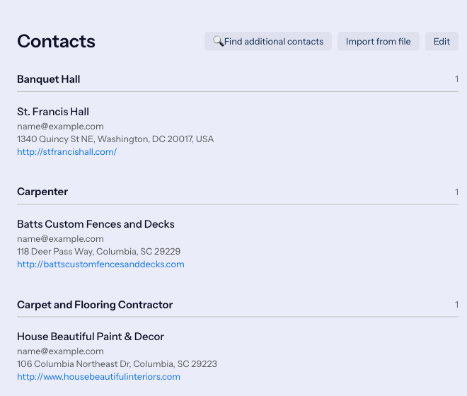
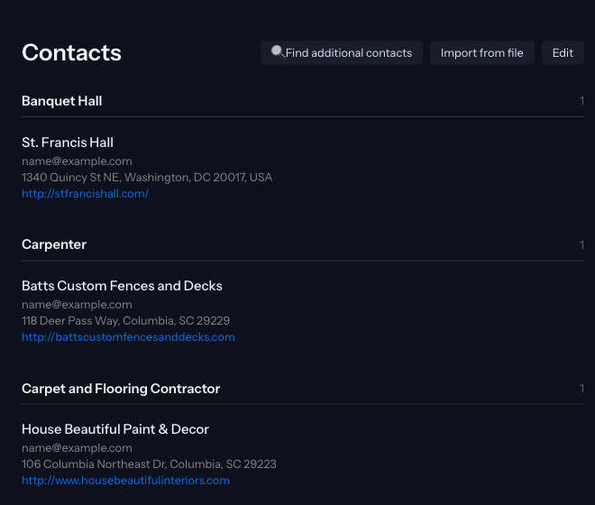
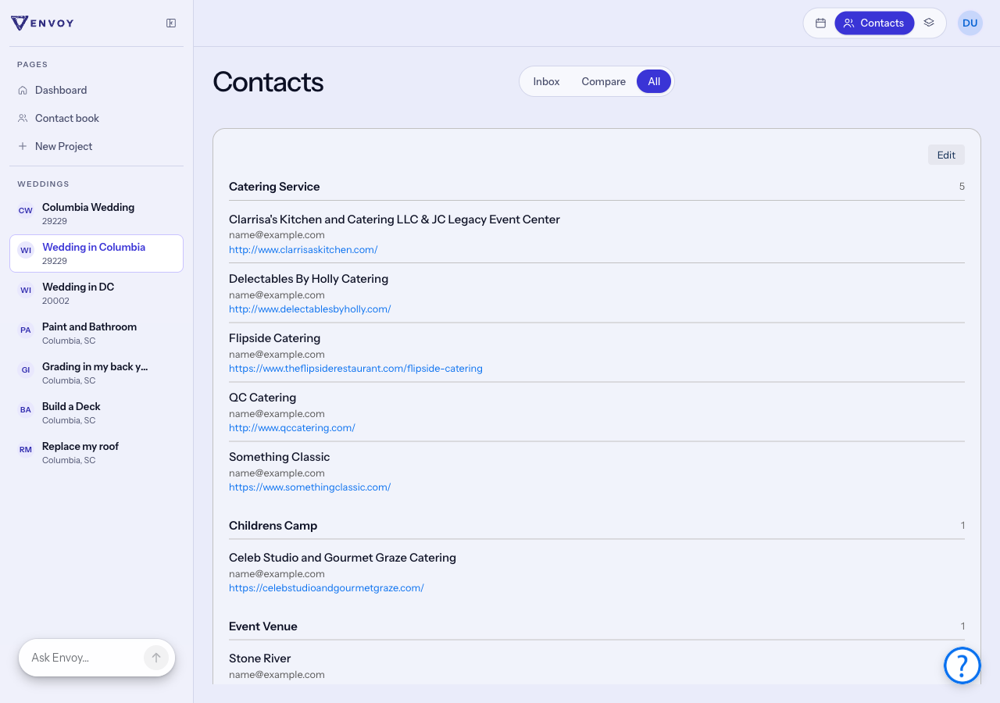
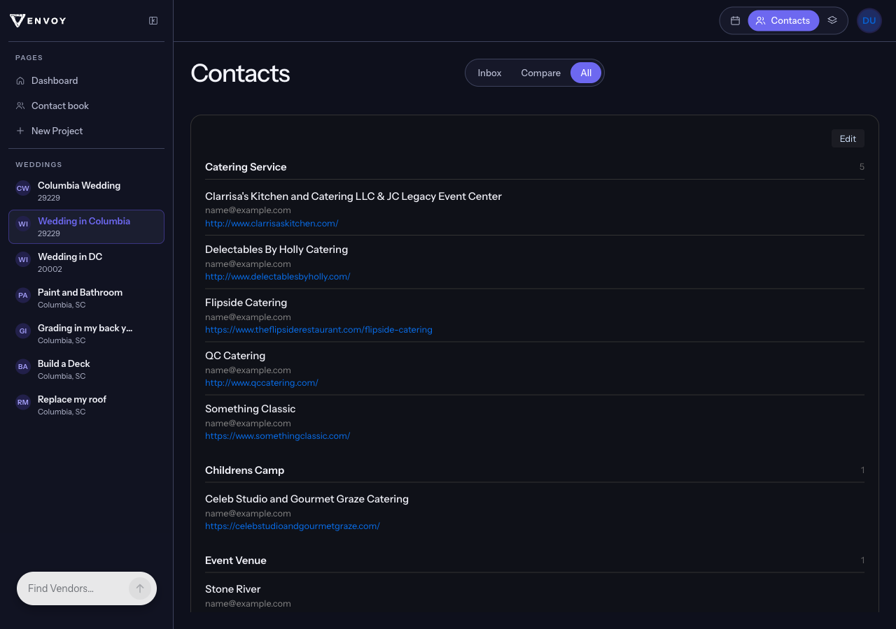

## What you'll learn

**Contacts** in Envoy are service providers, such as your florist, photographer, caterer, or venue. They are not a guest list and not a personal address book. **Contact book** on the left opens your directory of those service providers. You can reuse them across weddings.

## Getting there

Click **Contact book** on the left, or go to [Contacts](https://app.hello-envoy.com/contacts). The page is titled **Contacts**.

## What you can do

| Action | How |
|--------|-----|
| View all contacts | Browse the contacts list, grouped by type |
| Add a contact manually | **+ New contact** |
| Import contacts from a file | **Import from file** on this page. On a wedding, open **Contacts** → **All**, click **Edit**, then **Import from file**. Upload a `.csv` or `.xlsx` file, up to 5 MB. |
| Search for new contacts | **🔍 Find additional contacts**, or select contacts on the **Contacts** step when you create a project from **Dashboard**. On a wedding, you can also ask Envoy. See [Find contacts with Envoy](/help-center/ask-envoy/find-contacts). |
| Edit a contact | On **Contacts**, click **Edit** beside **Import from file** (it switches to **Done**), then **Edit** on the contact, and click **Save** or **Cancel** |
| Open a website | Select the website link on a contact row, when one is saved |
| Remove a contact | On **Contacts**, click **Edit**, then **Remove**. Confirm **Remove?** with **Yes** or **Cancel** |

Rows show a contact's location and website when they're known.

## Grouped by type

Envoy groups contacts by type. Contacts without a type appear under **Other**. A single group stays a flat list, and **Other** stays hidden when it would be the only group.

Contacts on a wedding use the same grouping on **Contacts** → **All**. Add an optional **Type** when you create a contact, and Envoy groups that contact under the type you enter. See [Add or upload contacts](/help-center/contacts/add-or-upload-contacts).

## Long directories

When you have many contacts, the **Contacts** page shows 10 at a time. Use the previous, next, and page controls to move through the list. A group carried over from the previous page is marked **(continued)**. That heading shows no count.

A wedding's **All** list also shows 10 at a time. A group continued from the previous page is marked **(continued)**, and that heading shows no count.

## Empty state

If you haven't added anyone yet:

> No contacts yet. Add your first contact…

Click **+ New contact**, **🔍 Find additional contacts**, or **Import from file** to get started.

## Your directory and a wedding

- **Contact book** — Your master list of service providers
- **Contacts** on a wedding — **Inbox** for email, **All** for the contacts on that wedding. **Compare** is not available yet.

On **All**, click **Edit**. Then use **+ Attach existing**, **+ New contact**, **🔍 Find new contacts**, or **Import from file**. The first time you open **Contacts** on a wedding, **Inbox** is selected. Open a different wedding and **Contacts** starts on **Inbox** again.

## Related

<CardGroup cols={2}>
  <Card title="Find contacts" icon="magnifying-glass" href="/help-center/contacts/find-contacts">
    Search for contacts from Contacts, a project, or when you create a project.
  </Card>
  <Card title="Add or upload contacts" icon="user-plus" href="/help-center/contacts/add-or-upload-contacts">
    Add a contact yourself, or upload a file and import contacts.
  </Card>
  <Card title="Attach to projects" icon="link" href="/help-center/contacts/attach-contacts-to-projects">
    Link contacts to a project for outreach.
  </Card>
  <Card title="Contact badges" icon="badge-check" href="/help-center/contacts/contact-badges-explained">
    Understand trust and verification badges.
  </Card>
</CardGroup>
