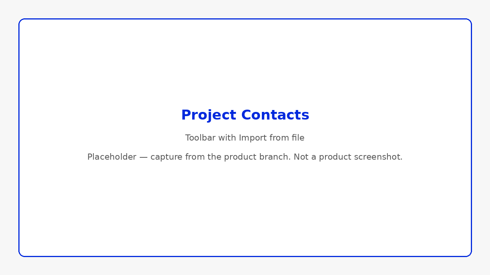
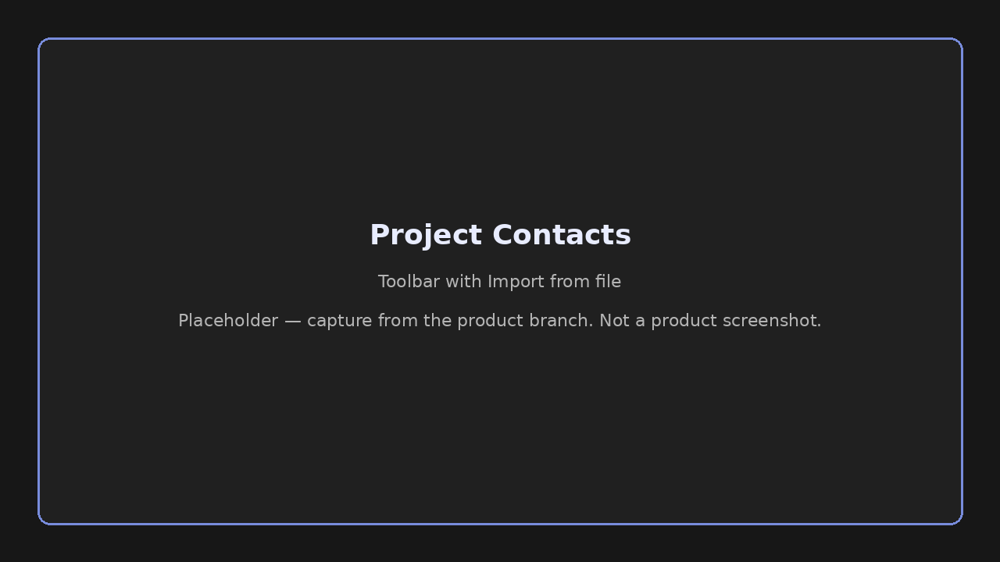
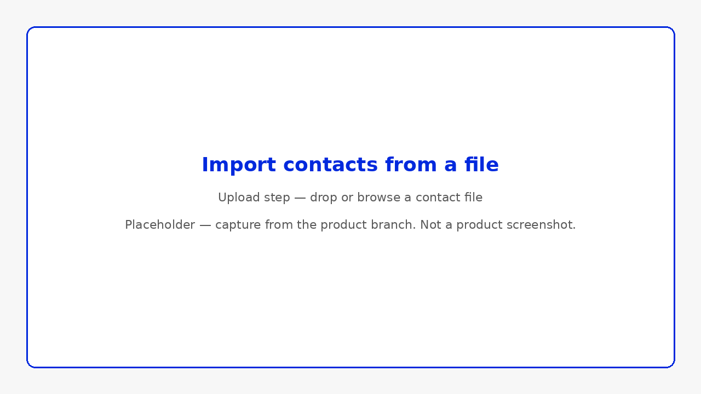
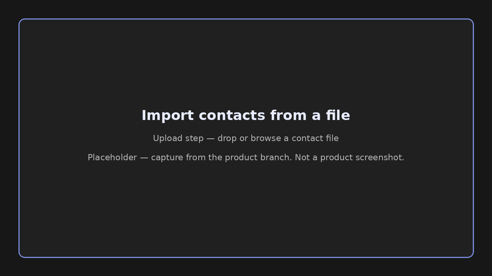
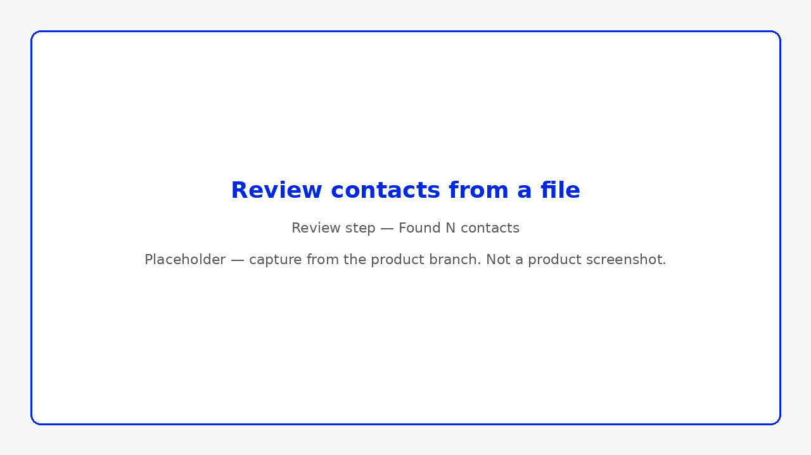
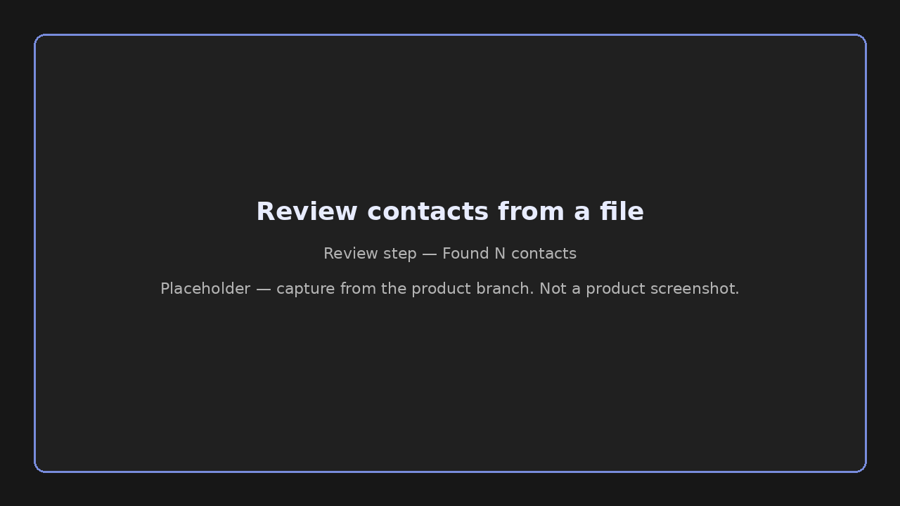

## What you'll accomplish

Add contacts to your directory by searching on the homepage, during project creation from **Dashboard**, by entering details manually, or by importing a file.

## Search for contacts

### From the Contacts page

1. Go to **Contacts**.
2. Click **🔍 Find additional contacts**.
3. Enter a project description and location.
4. Click **Search** and review grouped results. When a result includes a website, it shows as a link.
5. Select contacts to save. Saved contacts show a **Saved to Contacts** indicator.

### From a project

1. Open a project **Overview** tab.
2. Click **🔍 Find new contacts**.
3. Search, select, and add contacts directly to the project. When a result includes a website, it shows as a link.

### From project creation on the dashboard

1. From **Dashboard**, click **+ New project** or **New Project** in the sidebar.
2. Complete **Essentials**, then review results on the **Contacts** step. When a result includes a website, it shows as a link.
3. Select contacts to attach when the project is created, or click **Refine search** to adjust the description or location.

See [Create a project](/help-center/projects/create-a-project) for the full wizard steps.

## If no results appear

If you see **No matches found**, try:

- Describing the specific work you need (e.g., *bathroom tile replacement* instead of *renovation*)
- Verifying your ZIP or postal code
- Clicking **Search again** with a more detailed description

Very vague descriptions may return no matches even when your location is correct.

If the search stops before it finishes, see [Common issues](/help-center/troubleshooting/common-issues#contacts-and-search).

## Add a contact manually

1. On **Contacts**, click **+ New contact**.
2. Enter the contact's **Name** and **Email**.
3. Optionally enter a **Type**. Enter any label you want, such as *Florist* or *Photographer*. Envoy groups the contact under that type. Leave **Type** blank to place the contact under **Other** when groups are shown.
4. Optionally enter a **Website**, such as `example.com`. The website shows as a link on the contact row and in search results.
5. Click **Add Contact**.

You can enter the same optional **Type** and **Website** when you click **+ New contact** on a project **Overview** tab.

## Import contacts from a file

Add several contacts at once from a file. Each contact needs a name and an email address. Phone and website are optional.

### From the Contacts page

1. Go to **Contacts**.
2. Click **Import from file**, next to **🔍 Find additional contacts** and **Edit**.

### From a project

1. Open the project and go to the **Overview** tab.
2. In the **Contacts** section, click **Import from file**, next to **🔍 Find new contacts**.

Envoy opens a panel titled **Import contacts from a file**.

### Choose a file

1. Drop a `.csv`, `.xlsx`, or `.docx` file on the panel, or browse for one. The file must be 5 MB or smaller.
2. Click **Download a CSV template** if you want the expected columns.

The template columns are **Vendor Name**, **Email**, **Phone**, and **Website**. **Vendor Name** is the name of the contact. The template includes one example row. Envoy never imports that example row.

### Review the contacts

The panel shows **Found N contacts in**, followed by the file name. Envoy includes only the first 500 contacts. When the file has more, the panel notes that you should split the file and import the rest separately.

1. Edit **Name** or **Email** on a row that needs a change. Phone and website are shown under the name and email.
2. Check the contacts you want to import. Click **Select all** to check every row.
3. Click **Import N contacts**. On a project, the button reads **Import N contacts to project**.

Envoy calls out a row when:

- The name or email is missing
- The email address is not valid
- The email is the example from the template
- The same email appears more than once in the file
- The contact is already in **Contacts**

On a project, a contact that is already in **Contacts** is added to the project instead.

When a contact matches a verified Envoy listing with the same email or the same name, Envoy offers a choice that begins with "Use the verified listing". When that listing applies, the contact can show **Onboarded to Envoy**. See [Contact badges explained](/help-center/contacts/contact-badges-explained).

### Read the summary

After the import, Envoy summarizes what happened:

- New contacts
- Verified listing links
- Contacts already there
- Contacts added to the project
- Contacts skipped

Click **Import another file** to bring in another file, or click **Done** to close the panel.

<Note>
  If the file cannot be imported, Envoy shows one of these messages:

  - **Contact files must be 5 MB or smaller.**
  - **Upload a .csv, .xlsx, or .docx file.**
  - A message that begins with **No contacts were found** when Envoy finds no contacts in the file
  - **This file does not look like a CSV. Export it as CSV (UTF-8) and try again.**
</Note>

## Edit a contact

1. On **Contacts**, open edit mode for the contact.
2. Update **Name**, **Email**, or **Website**. You can leave **Email** blank.
3. Save your changes.

## Trusted listing matches

When adding a contact, Envoy may detect an existing trusted listing:

> A trusted listing may already exist

Choose one:

- **Use listing** — Link to the verified or existing listing in Envoy's directory
- **Create separate contact** — Save as a standalone entry in your directory

<Snippet file="snippets/badge-onboarded.mdx" />

## Remove a contact

1. On **Contacts**, enter remove/edit mode for the contact.
2. Confirm with **Yes**, or click **Cancel** to keep the contact.

## Related

- [Find contacts before signing up](/help-center/get-started/find-contacts-before-signing-up)
- [Contact badges explained](/help-center/contacts/contact-badges-explained)
- [Attach contacts to projects](/help-center/contacts/attach-contacts-to-projects)
