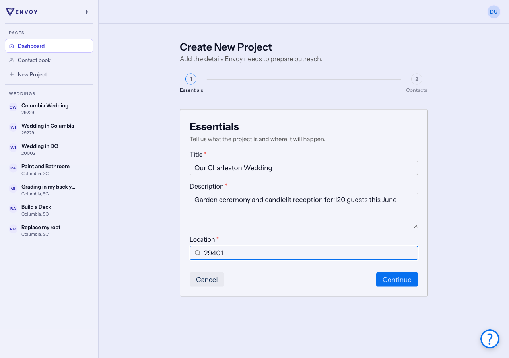
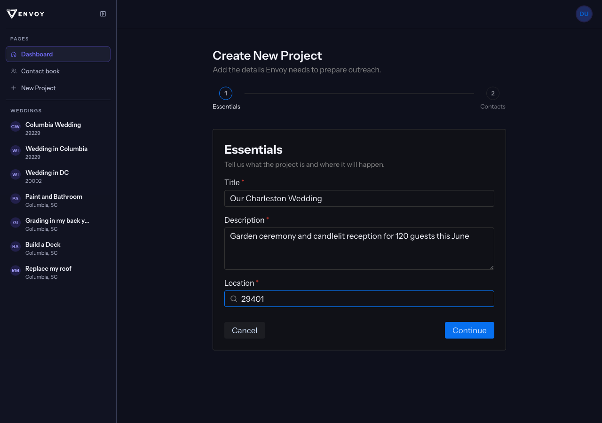

## What you'll accomplish

Create your first project with the post-registration wizard so Envoy can help you plan and reach out to your selected contacts.

## Before you start

- A completed Envoy account and consent preferences
- Contacts selected during homepage search (optional — you can add contacts later)

## The two-step wizard

After registration, Envoy opens the project wizard at `/onboarding/project`. The steps are:

### 1. Essentials

Tell Envoy what the project is and where it will happen:

- **Title** — A short name for your project
- **Description** — What you're planning (often prefilled from your homepage search)
- **Location** — Enter a ZIP code or full address, then select a suggestion

Click **Continue**.

### 2. Contacts

Review the contacts you selected before signing up:

- Contacts that already have an email show **Ready**
- If a contact is missing an email, enter one or click **Remove** to drop them from the project
- You can't finish until every remaining contact has a valid email

If you didn't select contacts before signing up, you'll see **No contacts selected.** You can still create the project and add contacts later from **Contacts** → **All**.

Click **Create project** to finish.

## After creation

Envoy opens the wedding on **Today**.

Add a **Budget** or **Deadline** anytime from **Project details**, or ask Envoy to set them. See [Update project details](/help-center/ask-envoy/update-project-details).

## If your session expired

If your pre-registration search expired, you'll see a recovery message instead of the wizard. From there you can:

- Go to **Dashboard** and create a project manually
- Start a new contact search from the homepage

## Related

- [Create a project](/help-center/projects/create-a-project)
- [Today](/help-center/projects/today)
- [Attach contacts to projects](/help-center/contacts/attach-contacts-to-projects)
