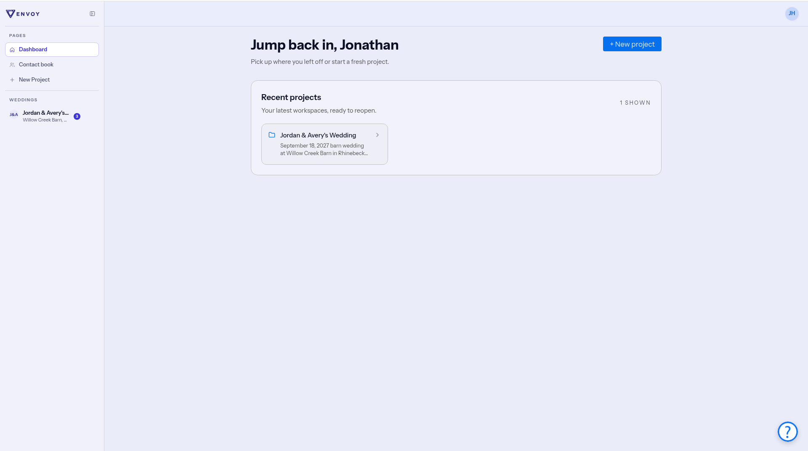
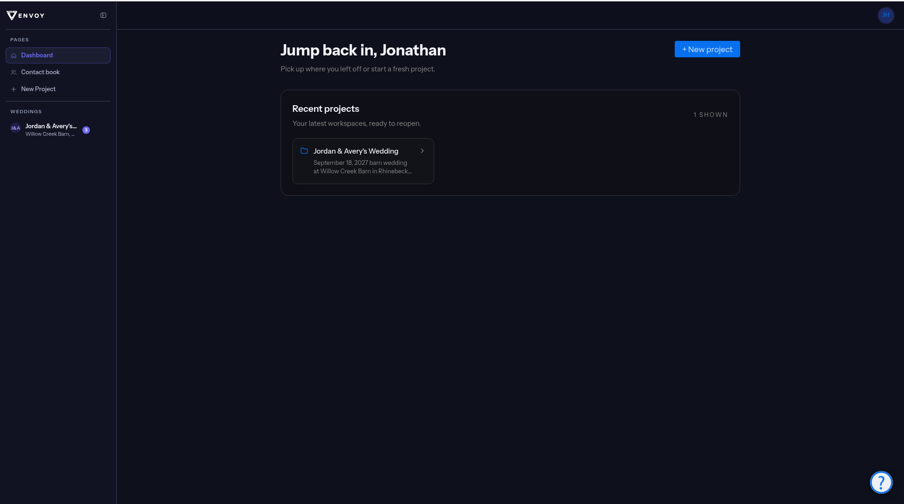
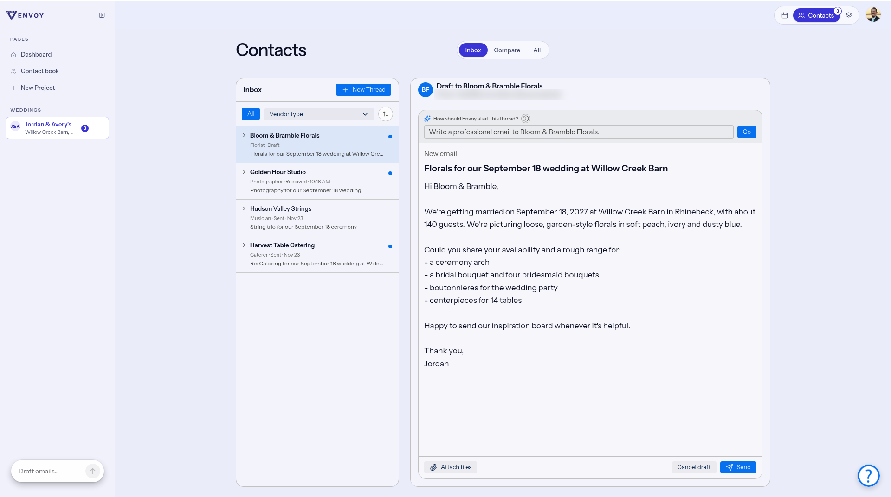
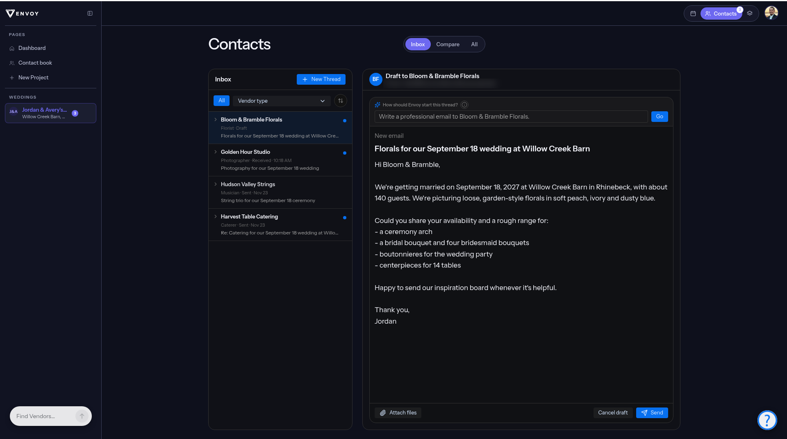
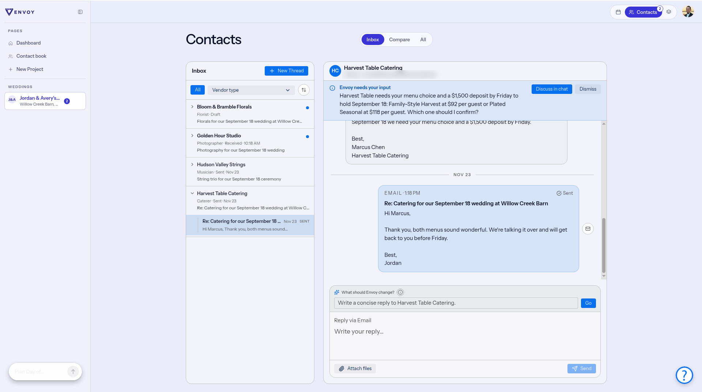
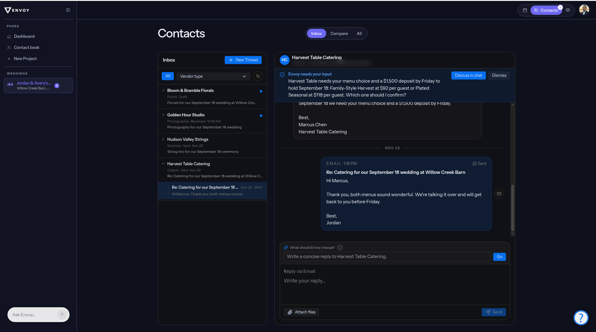

## What you'll learn

**Outreach** is email to the service providers (**Contacts**) on your project. It is not a day-of timeline. Envoy drafts messages for you; you review and approve every send.

## How outreach fits in

Outreach lives in **Inbox**, under **Contacts** on a wedding. **Inbox** is selected when you open **Contacts**. To use it, you need:

1. **Contacts attached** to the wedding (from **Contacts** → **All**)
2. **A connected inbox** — Gmail or Microsoft (from **Settings**)

<Snippet file="snippets/tip-connect-inbox.mdx" />

## The outreach inbox

**Outreach** lists each project contact collapsed. Expand a contact to see the threads nested under them.

- Filter the list by contact type.
- Sort by name, type, or date.
- Use **Needs attention** or **Received** to focus on threads that need you or that include a reply. See [When Outreach is waiting on you](#when-outreach-is-waiting-on-you).

## Drafts from Ask Envoy

If you finish planning with **Ask Envoy**, Envoy may already have prepared drafts for your attached contacts. Open **Inbox** to review them — you don't always need to start with **New message**. You still review and approve every send.

When planning is complete, Envoy tells you drafts are being prepared and directs you to **Inbox**.

## The outreach workflow

<Steps>
  <Step title="Connect your email">
    Link Gmail or Microsoft from **Settings → Connected Email Accounts**.
  </Step>
  <Step title="Attach contacts">
    Add contacts on **All** so they appear in **Inbox**.
  </Step>
  <Step title="Review or create a draft">
    Check **Inbox** for drafts prepared with [Ask Envoy](/help-center/ask-envoy/chat-planning). To start fresh, click **New message**, choose a contact, and click **Create draft**.
  </Step>
  <Step title="Review and send">
    Read the draft, attach files if needed, and use **Draft with Envoy** if you want a rewrite. Then click **Approve & Send**. Drafts are signed with your name.
  </Step>
  <Step title="Reply to responses">
    When contacts reply, expand the contact, open the thread, attach files if needed, and send replies from **Inbox**.
  </Step>
</Steps>

## Message statuses

| Status | Meaning |
|--------|---------|
| **Draft** | A message Envoy drafted, ready for your review |
| **Pending review** | Draft is being prepared or updated |
| **Sent** | Message was delivered from your inbox |
| **Received** | A reply arrived from the contact |
| **Send failed** | Delivery failed — use **Retry** to try again |
| **Needs attention** | Something requires your action (e.g., a failed send or reauthorization) |

## Simple vs Detailed

When viewing or revising messages, toggle between **Simple** and **Detailed** to control how much project context appears in the draft.

## When Outreach is waiting on you

When a conversation with a contact needs something from you, Envoy marks it so nothing slips.

Outreach is the email between you and the contacts on a wedding, in **Contacts** > **Inbox**.

In **Inbox**, a waiting conversation shows a dot, a bold subject, and a reason. The reasons are **Vendor replied**, **Draft ready to send**, and **Envoy needs your input**.

- **Vendor replied** means a contact replied.
- **Draft ready to send** means a draft is ready for you to review.
- A draft that couldn't be prepared uses **Draft ready to send** as well, and the status shows **Error**. Click **Retry draft generation** to try again.
- **Envoy needs your input** is the reason when Envoy has flagged the conversation.

The waiting count shows in three places:

- Your wedding in the sidebar (or each wedding, if you have more than one). Click **Collapse sidebar** and each wedding with something waiting shows a dot instead of a number.
- The **Contacts** tab shows the count for this wedding, on desktop and on a phone.
- The browser tab title adds the total across all your weddings, for example **(2) Envoy - Dashboard**.

Counts update by themselves. You don't need to refresh.

A flagged thread shows a banner: **Envoy needs your input**, with the reason.

- **Discuss in chat** opens **Ask Envoy** for this wedding, with the contact's name and the reason already filled in.
- **Dismiss** hides the banner on this thread. It doesn't send anything to the contact or change the thread.

Opening the conversation, or working on its draft, marks it as seen and removes it from your waiting count, even if you haven't replied. If you open one to come back to later, the count won't remind you. A newer reply, a newly finished draft, or a new flag puts it back in your count. The banner stays inside the conversation until you send on that thread or click **Dismiss**.

A count above 9 shows as **9+** on each wedding and on **Contacts**. The browser tab uses the full number.

## Related guides

<CardGroup cols={2}>
  <Card title="Connect your email" icon="envelope" href="/help-center/outreach/connect-your-email">
    Set up Gmail or Microsoft before your first send.
  </Card>
  <Card title="Create and send a message" icon="paper-plane" href="/help-center/outreach/create-and-send-a-message">
    Walk through your first outreach draft and send.
  </Card>
  <Card title="Email several wedding contacts" icon="paper-plane" href="/help-center/outreach/email-several-wedding-vendors">
    Approve a separate note for each contact on one wedding.
  </Card>
  <Card title="Attach files" icon="paperclip" href="/help-center/outreach/attach-files">
    Add files to drafts and replies, and download files from a thread.
  </Card>
  <Card title="Revise with Envoy" icon="sparkles" href="/help-center/outreach/revise-with-envoy">
    Rewrite a draft from the **Draft with Envoy** bar.
  </Card>
  <Card title="Troubleshoot outreach" icon="wrench" href="/help-center/outreach/troubleshoot-outreach">
    Fix common outreach issues.
  </Card>
</CardGroup>
