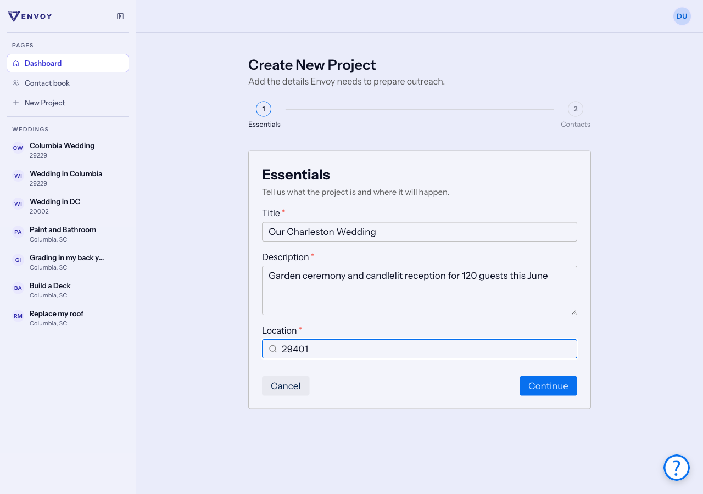
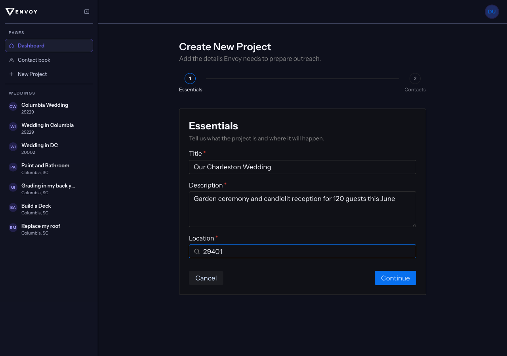

## What you'll accomplish

Create a new project from the dashboard with the **Essentials** → **Contacts** wizard.

## Before you start

- A signed-in Envoy account

<Tip>
  Set a [default project location](/help-center/account/account-settings#default-project-location) on **Account** to prefill **Location** for every new project. You can still change it per project.
</Tip>

## Steps

1. From **Dashboard**, click **+ New project** or **Create your first project**. On a phone, open the menu and tap **New Project**.

2. Complete the wizard steps:

   ### Essentials

   Tell Envoy what the project is and where it will happen:

   - **Title** — Name your project
   - **Description** — What you're planning (at least a short sentence)
   - **Location** — Enter a ZIP code or full address, then select a suggestion

   
   

   Click **Continue**.

   ### Contacts

   Envoy searches for contacts using your title, description, and location.

   - Review the grouped results and select who to add
   - Click **Refine search** if you want to adjust the description or location, then **Search again**
   - You can create the project with no contacts selected and add them later

3. Click **Create project**. If you selected contacts, the button shows **Create project + N contacts**.

## After creation

Envoy opens your new project on **Today**. Add a budget or deadline from **Project details**, or ask Envoy, then email from **Contacts** → **Inbox** when you're ready.

## Related

- [Complete your first project](/help-center/get-started/complete-your-first-project)
- [Today](/help-center/projects/today)
- [Find contacts](/help-center/contacts/find-contacts)
