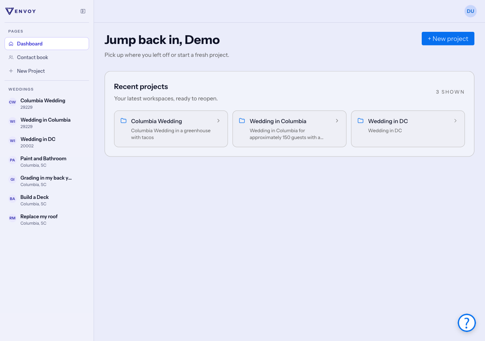
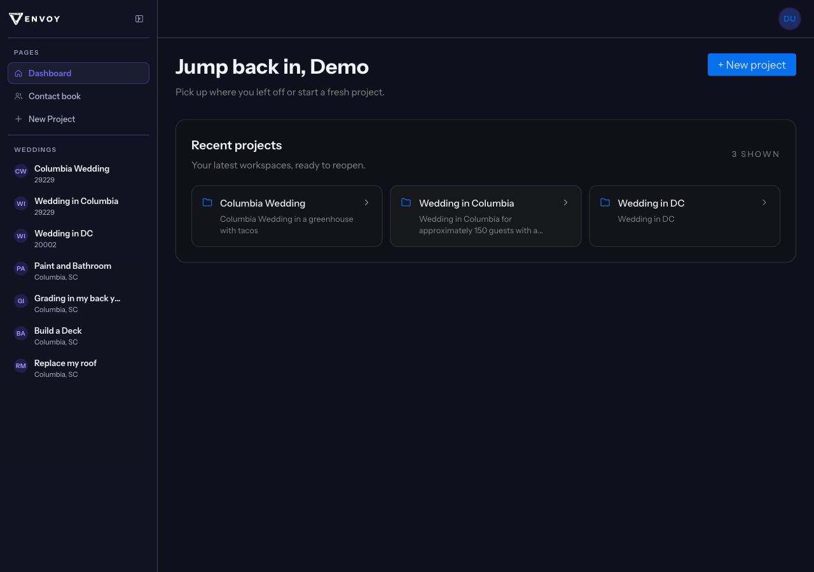
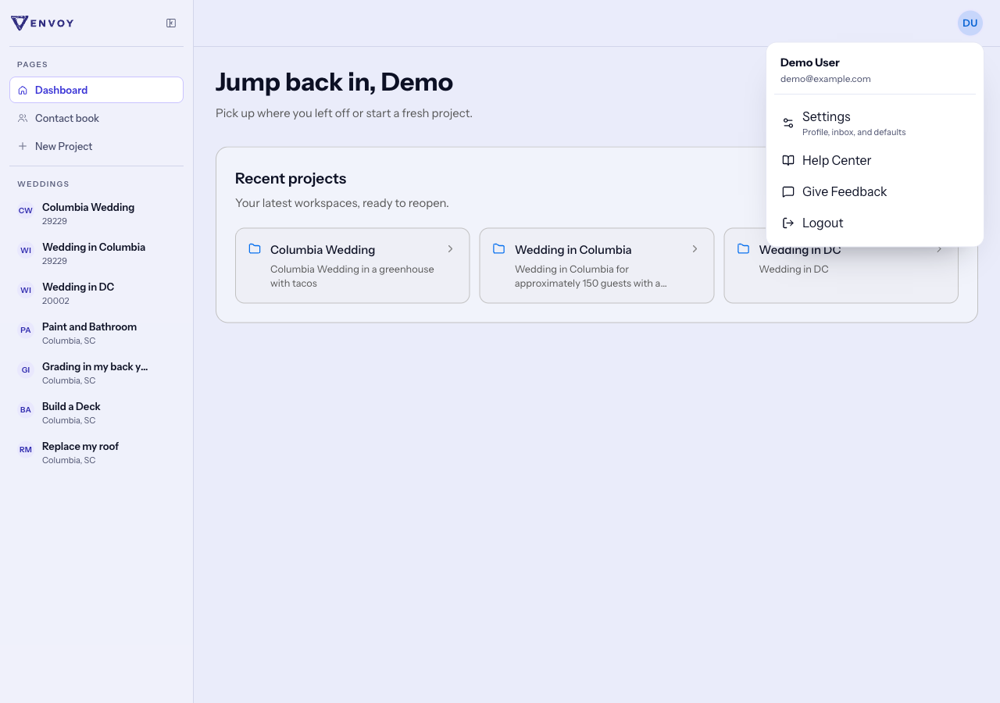
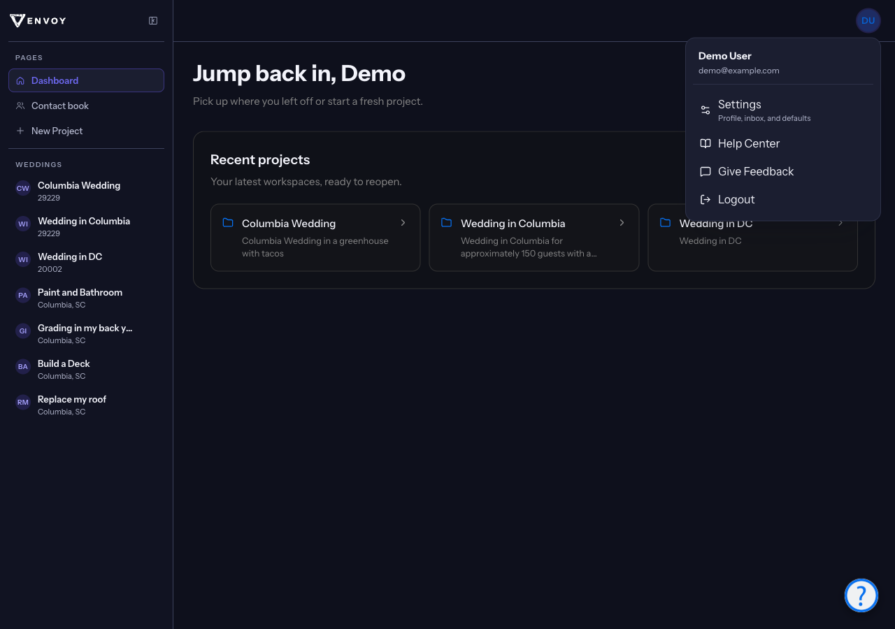

## What you'll learn

The **Dashboard** is your home base after signing in. It shows recent projects and gives you a way to create new ones.

## Getting there

Click **Dashboard** on the left, or go to [Dashboard](https://app.hello-envoy.com/dashboard).

**Ask Envoy** does not appear on **Dashboard**.

## What you'll see

### When you have projects

- A greeting: **Jump back in, [name]**
- **Recent projects** — Up to three of your most recent projects with quick links
- A **+ New project** button to start the creation wizard

### When you have no projects

If you haven't created a project yet, you'll see:

- **No projects yet**
- **Create your first project** — Opens the project wizard

## Around the app

The left side is on every signed-in page. Collapse it with **Collapse sidebar**. Open it again with **Expand sidebar**.

| What you see | Purpose |
|--------------|---------|
| **Dashboard** | Home and recent projects |
| **Contact book** | Your directory of service providers |
| **Weddings** | Every active wedding. Open one to work on it. |
| **Ask Envoy** | Planning for the open wedding. It appears on a wedding only. |

Your photo in the top right opens the account menu:

| Menu item | Purpose |
|-----------|---------|
| **Settings** | Profile, inbox, and defaults. Opens [Account](https://app.hello-envoy.com/account). |
| **Help Center** | These docs, in a new tab |
| **Give Feedback** | Shown when feedback is available |
| **Logout** | Sign out |

On a phone, open the menu for **Dashboard**, **Contact book**, **New Project**, and **Weddings**. Your photo stays at the top right. On a wedding, the top bar shows the wedding name, and the Envoy logo opens **Ask Envoy**.

In dark mode, the Envoy logo at the top left is white. The dark **Dashboard** image above shows that logo.

## Related

- [Create a project](/help-center/projects/create-a-project)
- [Today](/help-center/projects/today)
- [Contacts overview](/help-center/contacts/contacts-overview)
- [Account settings](/help-center/account/account-settings)
