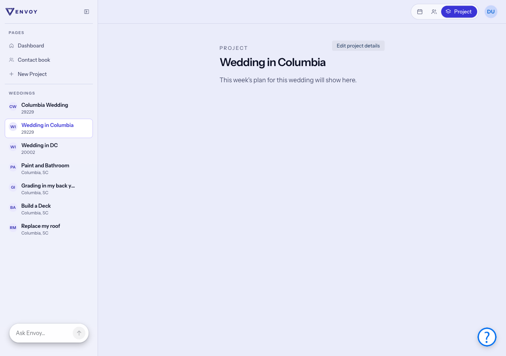
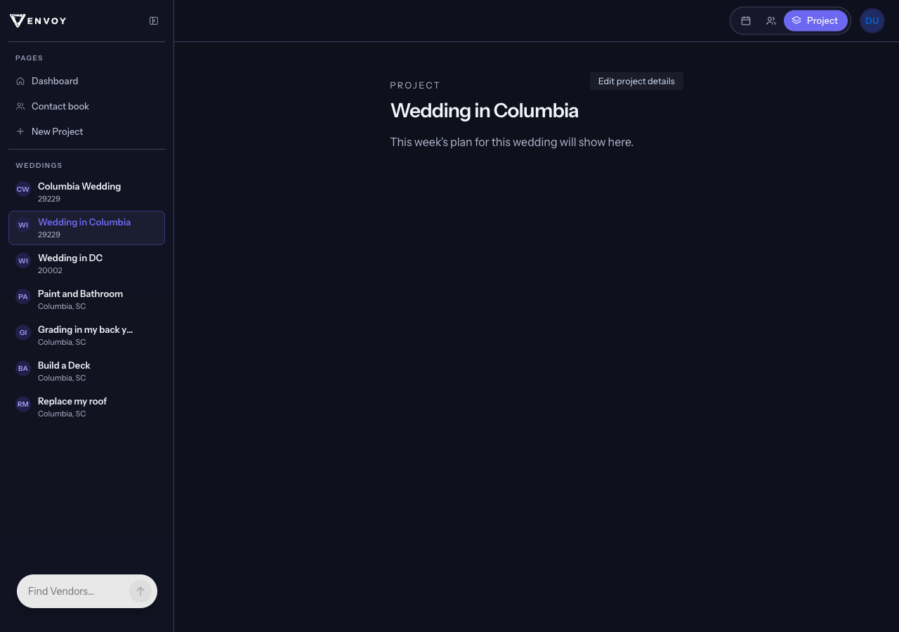

## What you'll accomplish

Open **Project** to see the wedding name and date, and to edit the details for this wedding.

## Open Project

1. Open a wedding from **Dashboard**, or from **Weddings** on the left.
2. Click **Project**.

**Project** shows the wedding name. When the wedding has a deadline, the date shows under the name. Click **Edit project details** to open **Project Details**.

A weekly plan is not available on **Project** yet.

## The same details form

**Edit project details** opens **Project Details**. Point at the wedding under **Weddings** and click **Project details** to open that same form. You stay on the tab you already had open.

See [Edit or delete a project](/help-center/projects/edit-or-delete-a-project) to change the title, description, location, budget, or deadline, or to delete the wedding.

You can also ask Envoy to save those fields. See [Update project details](/help-center/ask-envoy/update-project-details).

## Related

- [Today](/help-center/projects/today)
- [Edit or delete a project](/help-center/projects/edit-or-delete-a-project)
- [Update project details](/help-center/ask-envoy/update-project-details)
